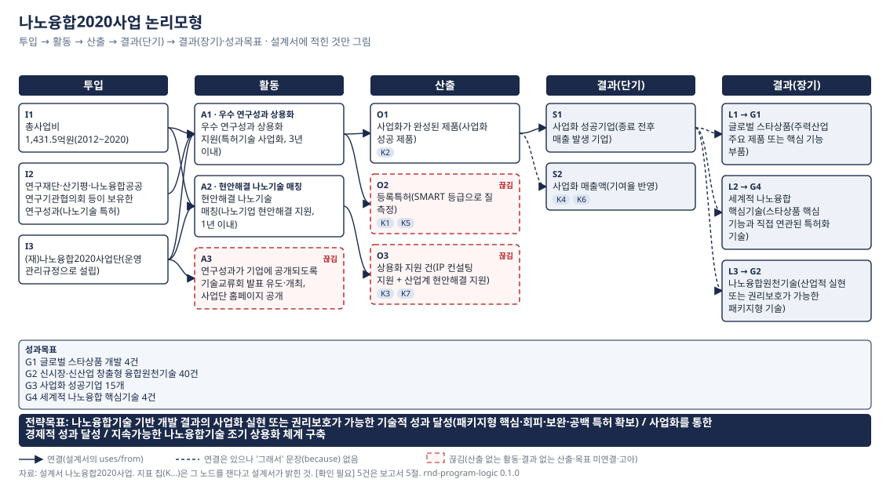

# rnd-program-logic — 사업 논리모형·성과지표 설계 점검기

사업이 "돈을 어떻게 성과로 바꾼다"고 말하는지를 다섯 칸(투입 → 활동 → 산출 → 결과 → 성과목표)에 적으면, 어디가 비었고 어느 연결이 끊겼는지, 성과지표가 제대로 된 것을 재는지, 목표치에 근거가 있는지를 점검해 **점검표·지표표·논리모형 그림**을 내는 도구입니다. 파이썬 파일 하나, 설치 없음.

[English](README.en.md)

## 왜 만들었나

정부 R&D 사업의 설명자료나 전략계획서를 보면 "지원한다·추진한다"는 활동은 많은데 그래서 무엇이 나오는지(산출), 그것이 누구에게 무엇을 바꾸는지(결과)가 문장으로 이어지지 않는 경우가 많습니다. 성과지표는 "논문 n편·과제 n건"처럼 세기 쉬운 것으로 채워지고, 목표치는 "전년 실적 대비 10% 상향"이 근거의 전부입니다. 평가에서는 이것이 그대로 지적 사항이 됩니다. 실제로 한 사업의 특정평가 보고서는 목표치 산출 근거 일곱 줄이 모두 "전년도 실적 및 추세 감안 n% 상향"이었고, 평가원은 그 타당성이 미흡하다고 적었습니다.

이 다섯 칸을 손으로 표에 그려 보면 끊긴 데가 보이기는 하는데, 사람이 눈으로 찾아야 하고 "어느 지침의 어느 항목에 걸리는가"를 매번 다시 찾아야 합니다. 그래서 그 절차를 코드로 옮겼습니다. 칸을 채우는 것은 사람이 하고, 빈 칸·끊김·근거 없는 목표치를 찾아 지침 항목과 함께 내보이는 것은 도구가 합니다. 문서에 없는 것을 도구가 메우지는 않습니다.

> **용어 한 줄** — 논리모형(logic model): 사업을 투입(돈·인력)–활동(하는 일)–산출(그 일의 직접 결과물)–결과(산출이 바꾼 상태)로 그린 그림. 산출은 "시제품 n건", 결과는 "그 시제품을 쓴 기업의 공급계약"처럼 다릅니다. 성과지표는 이 칸 가운데 산출·결과를 재는 것이어야 하고, 투입·과정(예산 집행률, 회의 횟수)을 재는 것은 성과지표가 아닙니다.

## 어떻게 쓰나

파일 하나를 복사하고 서식을 받아 채운 뒤 돌립니다.

```bash
curl -O https://raw.githubusercontent.com/parkjui92/rnd-program-logic/main/program_logic.py
python3 program_logic.py init --out program.yaml     # 1) 설계서 서식을 받는다
#   … program.yaml 을 사업 문서를 보며 채운다 (아래 예시)
python3 program_logic.py report program.yaml --out out   # 2) 점검표·지표표·그림을 한 번에
open out/report.md out/logic_model.html                  # 3) 읽는다
```

설계서는 이런 모양입니다. 칸마다 **문서의 문장을 그대로** 옮기고 출처(쪽)를 적습니다. 연결은 `uses`·`from`·`goal`로, 연결의 "그래서" 문장은 `because`에, 지표가 어느 칸을 재는지는 `measures`에 적습니다.

```yaml
name: 예시_소재부품상용화지원사업
period: {start: 2027, end: 2031, type: 기한}
program_type: 중장기산업기술개발        # 안내서의 10개 사업유형 중 하나
performance_goals:
  - {id: G1, text: "핵심 공백 기술의 수요기업 검증 통과", source: "사업설명자료 1쪽"}
chain:
  inputs:
    - {id: I1, text: "연 240억원(국비), 산·학·연 연구인력", source: "3쪽"}
  activities:
    - {id: A1, text: "공백 기술 과제 공모·선정·지원", uses: [I1], source: "5쪽"}
    - {id: A3, text: "성과 교류회 개최", uses: [I1], source: "6쪽"}        # 산출이 없다 → 끊김
  outputs:
    - {id: O2, text: "수요기업 검증 통과 기술", from: [A1], source: "5쪽"}
  outcomes_short:
    - {id: S1, text: "참여기업의 첫 공급계약 체결", from: [O2],
       because: "검증을 통과한 기술은 수요기업 품질승인 절차로 넘어간다", source: "7쪽"}
  outcomes_long:
    - {id: L2, text: "핵심 공백 기술의 국산 공급", from: [S1], goal: G1, because: "", source: "8쪽"}
indicators:
  - id: K2
    name: 수요기업 검증 통과율
    stage: 산출
    measures: O2
    goal: G1
    kind: 질적
    formula: "검증 통과 과제 수 / 실증 착수 과제 수 × 100"
    baseline: {year: 2025, value: 40, source: "유사사업 실적"}
    targets: {2028: 45, 2029: 50, 2030: 60, 2031: 70}
    target_basis: "유사사업 최고 실적 70%와 참여기업 역량을 고려"
    target_source: "사업설명자료 9쪽"
  - id: K5
    name: 공급망 진입 기업 수
    stage: 결과
    measures: L1
    kind: 양적
    targets: {2028: 5, 2029: 6, 2030: 7, 2031: 8}
    target_basis: "전년 실적 대비 10% 상향"                              # 기계적 점증 → 보완
```

돌리면 터미널에 판정이 찍히고 `out/report.md`에 표가 생깁니다. 점검표의 한 조각:

| 항목 | 판정 | 위치 | 내용 | 근거 지침 | 수정 제안 |
|---|---|---|---|---|---|
| C4 산출 없는 활동 | 끊김 | A3 | 활동 '성과 교류회 개최' 에서 나오는 산출이 없다 | 안내서(6차) Ⅲ.1 사업 분석 p.8~10 | 이 활동이 무엇을 내놓는지 문서에서 찾아 outputs 에 적는다. 문서에 없으면 끊김으로 둔다 |
| I2 투입·과정 지표 | 부적정 | K1 | '연간 예산 집행률' 은 투입지표 | 안내서 Ⅴ.3 ④ p.38 | 이 지표가 가리키는 산출·결과를 재는 지표로 바꾼다 |
| T4 기계적 점증 | 보완 | K5 | 연차별 목표치가 등차(+1/년) · 근거가 '전년 실적 대비 10% 상향' | 안내서 Ⅴ.5 ① p.42 | 과거 실적은 baseline 으로만 쓰고 도달 수준(최고 수준·로드맵)에서 끌어온다 |
| T2 목표치 근거 | 확인 필요 | K6 | 목표치 설정 근거가 없다 | 안내서 Ⅴ.5 ①·② | 근거 문장을 적는다. 문서에 없으면 [확인 필요]로 남긴다 — 지어내지 않는다 |

지표표의 한 조각:

| 지표 | 성과목표 | 재는 노드 | 단계 | 질적/양적 | 목표치 | baseline | 목표치 근거 | 지표 판정 |
|---|---|---|---|---|---|---|---|---|
| K2 수요기업 검증 통과율 | G1 | O2 (산출) | 산출 | 질적 | 2028: 45, 2029: 50, 2030: 60, 2031: 70 | 40 (2025) | 유사사업 최고 실적 70%… (9쪽) | 적정 |
| K5 공급망 진입 기업 수 | G2 | L1 (결과(장기)) | 결과 | 양적 | 2028: 5, … 2031: 8 | 4 (2025) | 전년 실적 대비 10% 상향 | 보완 (T4, T6) |
| K6 후속개발 착수 소요기간 | G1 | S2 (결과(단기)) | 결과 | 질적 | 2029: [확인 필요], … | [확인 필요] | [확인 필요] | 확인 필요 (T1, T2, T3) |

그림은 다섯 열로 그려지고, 끊긴 칸은 빨간 점선, "그래서" 문장이 없는 연결은 점선, 지표는 자기가 재는 칸 아래 칩으로 붙습니다.



명령은 다섯 개입니다.

| 명령 | 하는 일 |
|---|---|
| `init --out program.yaml` | 설계서 서식(주석에 칸마다 무엇을 적는지) |
| `check program.yaml --out out` | 점검만 → `check.json`. 끊김·부적정이 있으면 종료 코드 3 |
| `render program.yaml --out out` | 그림만 → `logic_model.svg/.html` + `figure_spec.json`([doc-figure](https://github.com/parkjui92/doc-figure) 스펙) |
| `report program.yaml --out out` | 전부 → `report.md` (`run`도 같음) |
| `evidence` | 점검 항목마다 어느 조문·지침 절을 따르는지와 원문 확인 상태 |

## 무엇을 하지 않나

- **문서에 없는 것을 메우지 않습니다.** 산출·결과·목표치·근거가 설계서에 없으면 `[확인 필요]`로 남기고, 그림의 빈 칸은 비워서 그립니다. 대체 지표나 목표치 숫자도 제안하지 않습니다.
- **'끊김'은 평가가 아닙니다.** 설계서에 연결이 적혀 있지 않다는 사실이며, 문서에 있는데 옮기지 않았을 수 있습니다.
- **글자를 봅니다.** 지표 이름과 산식이 뜻으로 같은 것을 재는지, 사업유형에 맞는 성과 분야인지는 사람이 봅니다. 산식에 "기여율"이 있으면 통과시키지만 그것으로 충분한지는 판정하지 않습니다.
- 실적·달성도·효과 추정은 [policy-did](https://github.com/parkjui92/policy-did), 출처 실재 확인은 [fact-verify](https://github.com/parkjui92/fact-verify), 문서를 읽고 칸을 채우는 앞 단계는 [rnd-eval-skills](https://github.com/parkjui92/rnd-eval-skills)의 `program-logic-check` 스킬이 맡습니다. 이 도구는 그 스킬의 점검 축(산출 없는 활동·결과 없는 산출·전략목표 미연결·투입의 결과 둔갑·내역사업 분기)과 `indicator-audit`의 지표 질문을 규칙으로 옮긴 것입니다.

## 점검 항목과 근거

| 묶음 | 항목 | 근거(원문 확인) |
|---|---|---|
| 사슬 C1~C12 | 전략·성과목표 존재 / 다섯 칸 / 참조 무결 / **산출 없는 활동** / **결과 없는 산출** / **전략목표 미연결** / 고아 노드 / '그래서' 문장 / **투입이 결과로 둔갑** / **내역사업 분기** / 사업유형·수명 주기 / 주변 여건 | 「국가연구개발사업 등의 성과평가 및 성과관리에 관한 법률」 제6조①② · 「국가재정법」 제85조의2①1 · 과기정통부 「국가연구개발사업 성과목표·지표 설정 안내서」(6차) Ⅲ.1 사업 분석·Ⅲ.2 사업유형 · 「제5차 국가연구개발 성과평가 기본계획」(2025-10-30 심의) |
| 지표 I1~I10 | 재는 노드·단계 일치 / 투입·과정 지표(**부적정**) / 성과목표별 2개 / 질적 과반 / 단순 건수 / 결과 지표 유무 / 산식 유무·과정 항목(**부적정**)·이름–산식 어긋남 / 매출·수출의 기여율·순효과 / 복합지표 / 비기초 논문 | 안내서 Ⅴ.3 ①~④ · Ⅴ.4 ①~④ · 부록3 · 같은 법 제3조⑤·제12조④ · KISTEP 「나노융합2020사업」 특정평가(2019) 권고 |
| 목표치 T1~T6 | 연차 목표치 / 설정 근거 / baseline / **기계적 점증**(등차·등비, '전년 실적 n% 상향') / 실적 저조로 하향(**부적정**) / 근거 출처 | 안내서 Ⅴ.5 ①~③ · Ⅴ.6 |

판정 등급: `오류`(설계서가 읽히지 않음) · `끊김`(사슬에 연결이 없음) · `부적정`(안내서가 "성과지표로 볼 수 없음"으로 단정한 것) · `보완`(지양·권장) · `확인 필요`(입력에 없음) · `적정`. 끊김·부적정이 하나라도 있으면 전체 FAIL.

**원문을 확인하지 못해 [확인 필요]로 둔 근거**: 기획재정부 「재정사업 자율평가 지침」의 평가항목(2026년부터 부처 자체평가가 폐지되고 통합 재정사업 성과평가로 바뀜, 보도 기준) · 「재정사업 성과관리 기본계획(2022~2026)」 · 특정평가 일반 지침. 이것들은 어떤 점검 항목의 1차 근거로도 쓰지 않았고, 확보되면 `EVIDENCE`에 절·쪽을 적어 상태를 올립니다. 안내서의 장 번호는 읽은 6차 추출본의 목차(성과지표 = Ⅴ장, 논리모형 = Ⅲ.1)를 따르며 쪽수를 함께 적었습니다.

설계 결정과 규칙의 세부는 [docs/design.md](docs/design.md)에 있습니다.

## 예시

- `examples/synthetic/` — 결함 11개를 일부러 심은 합성 사업(실존 사업 아님). 전부 잡히고 깨끗한 칸에는 오탐이 없는지가 테스트입니다.
- `examples/nano2020/` — **실제 공개 사업**: 나노융합2020사업(과기정통부·산업부, 2012~2020)을 KISTEP 특정평가 보고서(2019-10) 원문만으로 사후 재구성했습니다(`sources.md`에 쪽). 끊김 4·보완 14·확인 필요 5. 목표치 근거가 전부 "전년 실적·추세 n% 상향"이라 T4가 지표 5개에서 걸리는데, 평가원도 같은 자리를 지적했습니다. 평가원이 지적한 "매출의 1개 기업 62% 집중"은 설계서 점검으로는 나오지 않습니다 — 그것은 실적 자료의 몫입니다.

## 정직성 규칙 (출력에 그대로 찍힙니다)

1. **입력에 없는 것을 메우지 않는다.** 산출·결과·목표치·법령 조항이 설계서에 없으면 [확인 필요]로 남는다.
2. **'끊김'은 사실이지 평가가 아니다.**
3. **근거는 항목마다, 확인 상태와 함께.** 원문을 읽지 못한 지침은 '확인 필요'로 표시하고 1차 근거로 쓰지 않는다.
4. **대체 지표·목표치 숫자를 제안하지 않는다.** 수정 제안은 "무엇이 빠졌는가"까지다.
5. **기계가 보는 것은 글자다.** 뜻이 맞는지는 사람이 본다.
6. **설계서 sha를 출력에 적는다.** 설계서가 바뀌면 다시 돌린다.

## 검증 상태 (2026-10-20)

- tests 20건 통과(`python3 program_logic.py selftest`) — 내장 YAML 파서와 PyYAML의 일치(예시 2건), 합성 결함 11개 적발·오탐 0, 깨끗한 설계서는 끊김·부적정 0, 참조 오류·빈 칸·목표치 하향·이름–산식 어긋남 경로, 근거 대장 무결(확인이면 날짜·아니면 None), 보고서 8절·SVG 표기·doc-figure 스펙 5층
- 예시 2건 전 경로 산출(`examples/*/out/`), SVG는 브라우저에서 육안 확인
- 법 조문 4건은 국가법령정보 현행 원문, 안내서·기본계획·특정평가 보고서는 원문 추출본으로 대조

## 한계

- 글자 규칙이다. 안내서가 든 어긋남 사례 몇 쌍(활용도↔만족도 등)만 본다
- '영향(impact)' 칸은 그리지 않는다(안내서: 사업평가보다 효과성 분석의 대상). 필요하면 장기 결과에 적는다
- 내장 YAML 파서는 서식의 부분집합만 읽는다(앵커·다중행 블록 없음). PyYAML이 있으면 그것을 쓴다

## 라이선스

MIT. 인용한 법령은 국가법령정보센터, 안내서·기본계획·평가보고서는 각 발행기관의 저작물이며 여기에는 절·쪽 참조만 두었습니다.
