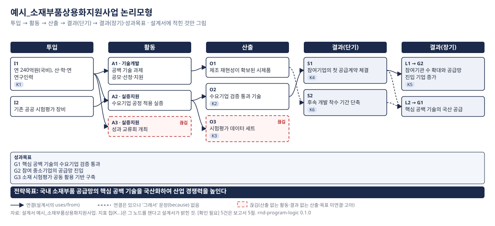

# 사업 논리모형·성과지표 점검 — 예시_소재부품상용화지원사업

판정 **FAIL** · 적정 9 · 끊김 3 · 보완 10 · 부적정 3 · 확인 필요 5 · 설계서 sha cd73696a3559b936 · 2026-10-20T23:22:08 · rnd-program-logic 0.1.0

## 0. 기본 칸

| 소관 | 기간(기한/계속) | 총사업비 | 사업유형 | 수명 주기 | 내역사업 |
|---|---|---|---|---|---|
| 예시부 | 2027~2031 (기한) | 1,200 억원 (예시 사업설명자료 3쪽) | 중장기산업기술개발 — [추정] 사업설명자료 2쪽 '3년 이상 상용화를 목표로' 문장 | 초기 | 기술개발, 실증지원 |

전략목표: 국내 소재부품 공급망의 핵심 공백 기술을 국산화하여 산업 경쟁력을 높인다 (예시 사업설명자료 1쪽)

- G1 핵심 공백 기술의 수요기업 검증 통과 (예시 사업설명자료 1쪽)
- G2 참여 중소기업의 공급망 진입 (예시 사업설명자료 1쪽)
- G3 소재 시험평가 공동 활용 기반 구축 (예시 사업설명자료 1쪽)

## 1. 사슬 표 (설계서에 적힌 문장 그대로)

| 칸 | id | 문장 | 상류 | 출처 |
|---|---|---|---|---|
| 투입 | I1 | 연 240억원(국비), 산·학·연 연구인력 | — | 예시 사업설명자료 3쪽 |
| 투입 | I2 | 기존 공공 시험평가 장비 | — | 예시 사업설명자료 4쪽 |
| 활동 | A1 | 공백 기술 과제 공모·선정·지원 | I1 | 예시 사업설명자료 5쪽 |
| 활동 | A2 | 수요기업 공정 적용 실증 | I1, I2 | 예시 사업설명자료 5쪽 |
| 활동 | A3 | 성과 교류회 개최 | I1 | 예시 사업설명자료 6쪽 |
| 산출 | O1 | 제조 재현성이 확보된 시제품 | A1 | 예시 사업설명자료 5쪽 |
| 산출 | O2 | 수요기업 검증 통과 기술 | A2 | 예시 사업설명자료 5쪽 |
| 산출 | O3 | 시험평가 데이터 세트 | A2 | 예시 사업설명자료 6쪽 |
| 결과(단기) | S1 | 참여기업의 첫 공급계약 체결 | O2 | 예시 사업설명자료 7쪽 |
| 결과(단기) | S2 | 후속 개발 착수 기간 단축 | O1 | 예시 사업설명자료 7쪽 |
| 결과(장기) | L1 | 참여기관 수 확대와 공급망 진입 기업 증가 | S1 → G2 | 예시 사업설명자료 8쪽 |
| 결과(장기) | L2 | 핵심 공백 기술의 국산 공급 | S1, S2 → G1 | 예시 사업설명자료 8쪽 |

## 2. 연결 판정

| 연결 | 설계서의 '그래서' 문장(because) | 판정 |
|---|---|---|
| I1 투입 → A1 활동 | — | 연결됨 |
| I1 투입 → A2 활동 | — | 연결됨 |
| I2 투입 → A2 활동 | — | 연결됨 |
| I1 투입 → A3 활동 | — | 끊김 |
| A1 활동 → O1 산출 | — | 연결됨 |
| A2 활동 → O2 산출 | — | 연결됨 |
| A2 활동 → O3 산출 | — | 끊김 |
| O2 산출 → S1 결과(단기) | 검증을 통과한 기술은 수요기업 품질승인 절차로 넘어간다 | 연결됨 |
| O1 산출 → S2 결과(단기) | — | 연결은 있으나 근거 문장 없음 |
| S1 결과(단기) → L1 결과(장기) | 공급계약이 쌓이면 공급망 진입 기업이 늘어난다 | 연결됨 |
| L1 → 성과목표 G2 | 공급계약이 쌓이면 공급망 진입 기업이 늘어난다 | 연결됨 |
| S1 결과(단기) → L2 결과(장기) | — | 연결은 있으나 근거 문장 없음 |
| S2 결과(단기) → L2 결과(장기) | — | 연결은 있으나 근거 문장 없음 |
| L2 → 성과목표 G1 | — | 연결됨 |

## 3. 점검표

| 항목 | 판정 | 위치 | 내용 | 근거 지침 | 수정 제안 |
|---|---|---|---|---|---|
| C4 산출 없는 활동 — 활동이 어떤 산출로도 이어지지 않음 | 끊김 | A3 | 활동 '성과 교류회 개최' 에서 나오는 산출이 없다(산출 없는 활동) | 과기정통부 「국가연구개발사업 성과목표·지표 설정 안내서」(6차) Ⅲ.1 사업 분석(논리모형) p.8~10 | 이 활동이 무엇을 내놓는지 문서에서 찾아 outputs 에 적고 from 으로 잇는다. 문서에 없으면 끊김으로 둔다 |
| C5 결과 없는 산출 — 산출이 어떤 결과로도 이어지지 않음 | 끊김 | O3 | 산출 '시험평가 데이터 세트' 이 어떤 결과로도 이어지지 않는다(결과 없는 산출) | 과기정통부 「국가연구개발사업 성과목표·지표 설정 안내서」(6차) Ⅲ.1 사업 분석(논리모형) p.8~10; 같은 안내서 부록3 설정 과정 예시 ④ 결과지표 도출 p.99~ | 이 산출이 누구에게 무엇을 바꾸는지(단기 결과)를 적고 from 으로 잇는다 |
| C6 전략목표 미연결 — 장기 결과가 성과목표(goal)에 닿지 않음 / 성과목표에 닿는 결과가 없음 | 끊김 | G3 | 성과목표 '소재 시험평가 공동 활용 기반 구축' 에 닿는 결과가 사슬에 없다 | 「국가연구개발사업 등의 성과평가 및 성과관리에 관한 법률」 제6조 ①·②; 같은 안내서 Ⅴ.3 성과지표 설정 주안점 ① p.33 | 이 목표를 이루는 결과 노드를 적거나, 목표가 사슬과 무관하면 그 사실을 보고한다 |
| C9 투입이 결과로 둔갑 — 결과 칸에 예산·과제 수·참여기관 수가 적혀 있음 | 부적정 | L1 | 결과 칸에 투입·과정 성격의 문구가 있다: '참여기관 수 확대와 공급망 진입 기업 증가' | 같은 안내서 Ⅴ.3 ④ p.38; 같은 법 제3조 ①·⑤ | 예산·과제 수·참여기관 수는 투입/활동 칸으로 옮기고, 결과 칸에는 그것이 바꾼 상태를 적는다 |
| I2 투입·과정 지표 | 부적정 | K1 | '연간 예산 집행률' 은 투입지표 — 예산만 투입하면 달성되는 지표는 성과지표로 쓰지 않는다 | 같은 안내서 Ⅴ.3 ④ p.38 | 이 지표가 가리키는 산출·결과를 재는 지표로 바꾼다. 관리용으로 필요하면 성과지표 표 밖에 둔다 |
| I7 산식이 있는가 / 산식에 과정 항목(위원회·회의·운영 건수)이 섞였는가 | 부적정 | K3 | '기술 확산 지수' 산식에 과정 항목이 섞여 있다: 기술 교류회 위원회 운영 건수 + 데이터 세트 공개 건수 | 같은 안내서 Ⅴ.4 측정방법 ① p.39; 같은 안내서 Ⅴ.4 ② p.39 | 위원회·회의·운영 건수 같은 과정 항목을 산식에서 뺀다 |
| C8 연결의 '그래서' 문장(because) — 산출→결과·결과→전략목표 연결에 논리 문장이 있는가 | 보완 | L2 | 결과(장기) '핵심 공백 기술의 국산 공급' 로 이어지는 '그래서' 문장(because)이 없다 | 과기정통부 「국가연구개발사업 성과목표·지표 설정 안내서」(6차) Ⅲ.1 사업 분석(논리모형) p.8~10; 같은 안내서 부록3 설정 과정 예시 ④ 결과지표 도출 p.99~ | 문서에서 'A이면 B'를 말하는 문장을 찾아 원문으로 옮긴다. 없으면 연결은 설계자의 가정이라는 뜻 — 보고서에 그렇게 적힌다 |
| C8 연결의 '그래서' 문장(because) — 산출→결과·결과→전략목표 연결에 논리 문장이 있는가 | 보완 | S2 | 결과(단기) '후속 개발 착수 기간 단축' 로 이어지는 '그래서' 문장(because)이 없다 | 과기정통부 「국가연구개발사업 성과목표·지표 설정 안내서」(6차) Ⅲ.1 사업 분석(논리모형) p.8~10; 같은 안내서 부록3 설정 과정 예시 ④ 결과지표 도출 p.99~ | 문서에서 'A이면 B'를 말하는 문장을 찾아 원문으로 옮긴다. 없으면 연결은 설계자의 가정이라는 뜻 — 보고서에 그렇게 적힌다 |
| I3 성과목표별 지표 2개 이상 | 보완 | G3 | 성과목표 G3 의 지표가 1개(2개 이상 권장) | 같은 안내서 Ⅴ.3 ② p.34~36 | 목표 달성도를 읽을 수 있는 지표를 더 둔다 |
| I8 외부요인·직접 수혜 — 매출·수출·생산액 지표에 기여율·순효과 처리가 있는가 | 보완 | K4 | '참여기업 매출액' 은 매출·수출·생산액 계열인데 기여율·직접 수혜·순효과 처리가 산식에도 external_factors 에도 없다 | 같은 안내서 Ⅴ.4 ③ p.39~40; KISTEP 「나노융합2020사업」 특정평가 보고서(2019-10, 19-3) 제2장·제4장 | 사업의 직접적 수혜분만 세는 기여율 또는 순효과 산식을 적는다. 특정평가는 매출 지표에 '동 사업의 직접적인 수혜금액 반영'을 요구한 이력이 있다 |
| T4 기계적 점증형 목표치(등차·등비, '전년 실적 대비 n% 상향'식 근거) | 보완 | K3 | '기술 확산 지수' 의 연차별 목표치가 등차(+2/년) 로 기계적 점증형이다: 2028=10, 2029=12, 2030=14 | 같은 안내서 Ⅴ.5 목표치 ① p.42; KISTEP 「나노융합2020사업」 특정평가 보고서(2019-10, 19-3) 제2장·제4장 | 연도별 도달 근거(로드맵·단계 목표)를 적거나 목표치 유형(상승형·지속형·시한형)을 밝힌다 |
| T4 기계적 점증형 목표치(등차·등비, '전년 실적 대비 n% 상향'식 근거) | 보완 | K4 | '참여기업 매출액' 의 연차별 목표치가 등차(+100/년) 로 기계적 점증형이다: 2029=400, 2030=500, 2031=600 | 같은 안내서 Ⅴ.5 목표치 ① p.42; KISTEP 「나노융합2020사업」 특정평가 보고서(2019-10, 19-3) 제2장·제4장 | 연도별 도달 근거(로드맵·단계 목표)를 적거나 목표치 유형(상승형·지속형·시한형)을 밝힌다 |
| T4 기계적 점증형 목표치(등차·등비, '전년 실적 대비 n% 상향'식 근거) | 보완 | K5 | '공급망 진입 기업 수' 의 목표치 근거가 전년 실적·추세 대비 상향식이다: '전년 실적 대비 10% 상향' | 같은 안내서 Ⅴ.5 목표치 ① p.42; KISTEP 「나노융합2020사업」 특정평가 보고서(2019-10, 19-3) 제2장·제4장 | 과거 실적은 baseline 으로만 쓰고, 도달해야 할 수준(최고 수준·로드맵)에서 목표치를 끌어온다 |
| T4 기계적 점증형 목표치(등차·등비, '전년 실적 대비 n% 상향'식 근거) | 보완 | K5 | '공급망 진입 기업 수' 의 연차별 목표치가 등차(+1/년) 로 기계적 점증형이다: 2028=5, 2029=6, 2030=7, 2031=8 | 같은 안내서 Ⅴ.5 목표치 ① p.42; KISTEP 「나노융합2020사업」 특정평가 보고서(2019-10, 19-3) 제2장·제4장 | 연도별 도달 근거(로드맵·단계 목표)를 적거나 목표치 유형(상승형·지속형·시한형)을 밝힌다 |
| T6 목표치 근거의 출처(target_source) | 보완 | K1 | '연간 예산 집행률' 의 목표치 근거에 출처가 없다 | 같은 안내서 Ⅴ.5 ② p.42 | 근거 문장의 문서·쪽을 적는다 |
| T6 목표치 근거의 출처(target_source) | 보완 | K5 | '공급망 진입 기업 수' 의 목표치 근거에 출처가 없다 | 같은 안내서 Ⅴ.5 ② p.42 | 근거 문장의 문서·쪽을 적는다 |
| T1 연차별·단계별 목표치가 있는가 | 확인 필요 | K6 | '후속개발 착수 소요기간' 의 연차별 목표치가 없다 | 「국가연구개발사업 등의 성과평가 및 성과관리에 관한 법률」 제6조 ①·②; 같은 안내서 Ⅴ.5 목표치 ① p.42 | 문서의 목표치를 연도별로 적는다. 문서에 없으면 [확인 필요]로 남긴다 — 지어내지 않는다 |
| T2 목표치 설정 근거(target_basis)가 있는가 | 확인 필요 | K6 | '후속개발 착수 소요기간' 의 목표치 설정 근거가 없다 | 같은 안내서 Ⅴ.5 목표치 ① p.42; 같은 안내서 Ⅴ.5 ② p.42 | 세계·국내 최고 수준, 역량, 예산, 로드맵 등 근거 문장을 적는다. 안내서는 근거 제시를 '반드시'로 적는다 |
| T3 baseline(준거 기준)이 있는가 | 확인 필요 | K1 | '연간 예산 집행률' 의 baseline 이 없다 | 같은 안내서 Ⅴ.5 ③ p.42~43 | 준거가 될 기준값과 연도·출처를 적는다(안내서 6문답의 첫째) |
| T3 baseline(준거 기준)이 있는가 | 확인 필요 | K3 | '기술 확산 지수' 의 baseline 이 없다 | 같은 안내서 Ⅴ.5 ③ p.42~43 | 준거가 될 기준값과 연도·출처를 적는다(안내서 6문답의 첫째) |
| T3 baseline(준거 기준)이 있는가 | 확인 필요 | K6 | '후속개발 착수 소요기간' 의 baseline 이 없다 | 같은 안내서 Ⅴ.5 ③ p.42~43 | 준거가 될 기준값과 연도·출처를 적는다(안내서 6문답의 첫째) |
| C1 전략목표·성과목표가 설계서에 있는가 | 적정 | performance_goals | 성과목표 3개 | 「국가연구개발사업 등의 성과평가 및 성과관리에 관한 법률」 제6조 ①·②; 「제5차 국가연구개발 성과평가 기본계획(2026~2030)」(국가과학기술자문회의 심의회의 2025-10-30 의안 제1호 별지) | — |
| C1 전략목표·성과목표가 설계서에 있는가 | 적정 | strategic_goal | 전략목표 있음 | 「국가연구개발사업 등의 성과평가 및 성과관리에 관한 법률」 제6조 ①·②; 「제5차 국가연구개발 성과평가 기본계획(2026~2030)」(국가과학기술자문회의 심의회의 2025-10-30 의안 제1호 별지) | — |
| C10 내역사업 분기 — 내역사업이 둘 이상인데 성과목표·지표가 내역을 구분하지 않음 | 적정 | sub_programs | 내역 2개, 내역 표시 활동 3·지표 0·목표 0 | 같은 안내서 Ⅴ.3 성과지표 설정 주안점 ① p.33 | — |
| C11 사업유형·수명 주기가 적혀 있는가(유형별 기대 성과 판단의 전제) | 적정 | program_type | 사업유형 중장기산업기술개발 | 같은 안내서 Ⅲ.2 R&D 사업 유형 결정 p.11; 같은 안내서 Ⅴ.3 ② p.34~36 | — |
| C12 주변 여건(외부 환경·동시 추진 사업)이 적혀 있는가 | 적정 | context | 주변 여건 있음 | 과기정통부 「국가연구개발사업 성과목표·지표 설정 안내서」(6차) Ⅲ.1 사업 분석(논리모형) p.8~10 | — |
| C2 사슬 다섯 칸(투입·활동·산출·결과 단기·결과 장기)이 비어 있지 않은가 | 적정 | chain | 다섯 칸 모두 채워짐 | 과기정통부 「국가연구개발사업 성과목표·지표 설정 안내서」(6차) Ⅲ.1 사업 분석(논리모형) p.8~10; 「국가재정법」 제85조의2 ①1 | — |
| C3 참조 ID가 실재하는가(uses/from/goal/measures) | 적정 | ids | 참조 무결 | 과기정통부 「국가연구개발사업 성과목표·지표 설정 안내서」(6차) Ⅲ.1 사업 분석(논리모형) p.8~10 | — |
| I4 질적 지표 과반 | 적정 | indicators | 질적 지표 3/6(50%) | 같은 안내서 Ⅴ.3 ④ p.38; 같은 법 제3조 ①·⑤; 같은 법 제12조 ④ | — |
| I6 결과 단계 지표의 유무(계속사업은 산출·결과 병행, 기한사업은 단계별) | 적정 | indicators | 결과 단계 지표 3개 (기한사업) | 같은 안내서 Ⅴ.3 ③ p.37 | — |

## 4. 지표표

| 지표 | 성과목표 | 재는 노드 | 단계 | 질적/양적 | 산식 | 목표치 | baseline | 목표치 근거 | 외부요인 처리 | 지표 판정 |
|---|---|---|---|---|---|---|---|---|---|---|
| K1 연간 예산 집행률 | G1 | I1 (투입) | 투입 | 양적 | 집행액 / 예산액 × 100 | 2027: 95, 2028: 95, 2029: 95 | [확인 필요] | 통상 수준 | — | 부적정 (I2, T3, T6) |
| K2 수요기업 검증 통과율 | G1 | O2 (산출) | 산출 | 질적 | 검증 통과 과제 수 / 실증 착수 과제 수 × 100 | 2028: 45, 2029: 50, 2030: 60, 2031: 70 | 40 (2025) | 유사사업 최고 실적 70%(예시 자료 9쪽)와 참여기업 역량을 고려 (예시 사업설명자료 9쪽) | — | 적정 (—) |
| K3 기술 확산 지수 | G3 | O3 (산출) | 산출 | 양적 | 기술 교류회 위원회 운영 건수 + 데이터 세트 공개 건수 | 2028: 10, 2029: 12, 2030: 14 | [확인 필요] | 운영 계획 (예시 운영계획 2쪽) | — | 부적정 (I7, T3, T4) |
| K4 참여기업 매출액 | G2 | S1 (결과(단기)) | 결과 | 질적 | ∑ 참여기업 당해연도 매출액 | 2029: 400, 2030: 500, 2031: 600 | 300 (2025) | 시장 성장률 전망(예시 자료 10쪽) (예시 사업설명자료 10쪽) | — | 보완 (I8, T4) |
| K5 공급망 진입 기업 수 | G2 | L1 (결과(장기)) | 결과 | 양적 | 당해연도 신규 공급계약 체결 기업 수 | 2028: 5, 2029: 6, 2030: 7, 2031: 8 | 4 (2025) | 전년 실적 대비 10% 상향 | — | 보완 (T4, T6) |
| K6 후속개발 착수 소요기간 | G1 | S2 (결과(단기)) | 결과 | 질적 | 완료 과제의 후속개발 착수까지 평균 개월 수 | 2029: [확인 필요], 2030: [확인 필요], 2031: [확인 필요] | [확인 필요] | [확인 필요] | — | 확인 필요 (T1, T2, T3) |

## 5. 지어내지 않은 것 — 입력에 없어 [확인 필요]로 남긴 것

- [확인 필요] T3 K1: '연간 예산 집행률' 의 baseline 이 없다
- [확인 필요] T3 K3: '기술 확산 지수' 의 baseline 이 없다
- [확인 필요] T1 K6: '후속개발 착수 소요기간' 의 연차별 목표치가 없다
- [확인 필요] T2 K6: '후속개발 착수 소요기간' 의 목표치 설정 근거가 없다
- [확인 필요] T3 K6: '후속개발 착수 소요기간' 의 baseline 이 없다

근거 지침 가운데 원문을 확인하지 못한 것:

- [확인 필요] KISTEP/과기정통부 특정평가 일반 지침·지표 점검 항목(「(가칭)국가연구개발 특정평가 세부 운영규정」 등) — 제5차 기본계획이 '마련' 예정으로 적은 규정. 공개 원문을 확보하지 못함
- [확인 필요] 기획재정부 「재정사업 자율평가 지침」(연도별) 평가항목·지표 — 2023년 개편 공통평가 항목(사업계획 적정성·집행 효율성·성과달성도·환류)은 보도(뉴시스 2023-01-02)로만 확인. 세부 질문·배점 원문 미확보. 2026년부터 부처 자체평가는 폐지되고 통합 재정사업 성과평가로 바뀜(기획예산처 2026-01-27 국무회의 보고, 보도 기준) — 통합평가 세부 지표도 미확보
- [확인 필요] 기획재정부 「재정사업 성과관리 기본계획(2022~2026)」 — 국가재정법 제85조의2에 따른 5년 기본계획. 원문 미확보

## 6. 논리모형 그림

## 7. 근거 표 — 점검 항목이 따르는 지침·조문

| 근거 | 내용(요지) | 확인 상태 | 확인 방법 |
|---|---|---|---|
| 「국가연구개발사업 등의 성과평가 및 성과관리에 관한 법률」 제6조 ①·② | 사업 전략계획에 전략목표, 전략목표를 달성하기 위한 연차별·단계별 성과목표 및 성과지표, 평가계획이 들어가야 한다 | 확인 2026-10-20 | 국가법령정보(법령ID 010090, 시행 2023-10-31) 조문 대조 |
| 같은 법 제3조 ①·⑤ | 평가는 성과 중심(①), 질적 성과지표에 가중치(⑤) | 확인 2026-10-20 | 국가법령정보 조문 대조 |
| 같은 법 제12조 ④ | 표준 성과지표에는 질적 성과지표가 포함되어야 한다 | 확인 2026-10-20 | 국가법령정보 조문 대조 |
| 「국가재정법」 제85조의2 ①1 | 성과목표관리 = 성과목표·성과지표 등의 설정 및 그 달성을 위한 집행과정·결과의 관리 | 확인 2026-10-20 | 국가법령정보(시행 2026-09-11) 조문 대조 |
| 과기정통부 「국가연구개발사업 성과목표·지표 설정 안내서」(6차) Ⅲ.1 사업 분석(논리모형) p.8~10 | 투입⟶과정⟶산출⟶결과의 인과관계를 전제로 구성요소 간 연계성을 고려; 활동별로 하나 이상의 산출; 단기 3년 이내·중기 3~5년·장기 6년 이후; 주변 여건(외부 환경)을 포함; '영향'은 효과성 분석의 대상 | 확인 2026-10-20 | 안내서 추출본 원문 대조(목차 쪽수 기준) |
| 같은 안내서 Ⅲ.2 R&D 사업 유형 결정 p.11 | 10개 사업유형(기초연구·단기산업·중장기산업·공공기술·지역·국방·인력양성·시설장비·성과확산·국제협력); 사업 분석을 거쳐 부처가 정하고 전략계획서 점검에서 확정 | 확인 2026-10-20 | 안내서 추출본 원문 대조 |
| 같은 안내서 Ⅴ.3 성과지표 설정 주안점 ① p.33 | 성과목표와 연계·부합; 내역사업이 둘 이상이면 사업별 성과를 대표할 지표; 지나치게 일반화된 지표 지양 | 확인 2026-10-20 | 안내서 추출본 원문 대조 |
| 같은 안내서 Ⅴ.3 ② p.34~36 | 사업유형별 핵심성과(초기/중기/장기); 기초연구 아닌 유형에서 논문 지표 가중치 과다 지양; 성과목표별 지표 2개 이상 | 확인 2026-10-20 | 안내서 추출본 원문 대조 |
| 같은 안내서 Ⅴ.3 ③ p.37 | 계속사업은 산출단계와 결과단계 지표를 병행; 기한사업은 사전 계획된 지표를 진척에 따라 단계적으로 | 확인 2026-10-20 | 안내서 추출본 원문 대조 |
| 같은 안내서 Ⅴ.3 ④ p.38 | 원칙적으로 질적 지표; 예산만 투입하면 달성되는 투입·과정지표 지양; 논문·특허·보고서 단순 건수 지양; 과반을 질적 지표로 권장 | 확인 2026-10-20 | 안내서 추출본 원문 대조 |
| 같은 안내서 Ⅴ.4 측정방법 ① p.39 | 측정산식이 지표명·지표 개념에 부합하지 않는 경우 지양 | 확인 2026-10-20 | 안내서 추출본 원문 대조 |
| 같은 안내서 Ⅴ.4 ② p.39 | 산식 세부항목이 투입·과정지표(위원회 구성·운영 건수 등)로 구성되면 적절한 성과지표로 볼 수 없음 | 확인 2026-10-20 | 안내서 추출본 원문 대조 |
| 같은 안내서 Ⅴ.4 ③ p.39~40 | 객관적 측정; 지원받지 않은 대상까지 포함하는 산식 부적절; 수출액·수입대체 등은 외부요인을 제외한 순효과로 측정; 사업화 매출은 기여율 반영 | 확인 2026-10-20 | 안내서 추출본 원문 대조(보완 사례 ③ 포함) |
| 같은 안내서 Ⅴ.4 ④ 및 보완 사례 ④ p.41 | 정성 지표도 수치·등급으로 객관화; 서로 다른 성격의 지표를 단순 합한 복합지표 지양 | 확인 2026-10-20 | 안내서 추출본 원문 대조 |
| 같은 안내서 Ⅴ.5 목표치 ① p.42 | 설정 근거(세계·국내 최고 수준, 현재 역량, 예산 등)를 반드시 제시; 과거 실적은 baseline으로만, 기계적 점증형 목표치는 주의 | 확인 2026-10-20 | 안내서 추출본 원문 대조 |
| 같은 안내서 Ⅴ.5 ② p.42 | 도전적이되 달성 불가능한 목표치 지양; 사례·전문가 판단 등 근거 정보를 반드시 제시 | 확인 2026-10-20 | 안내서 추출본 원문 대조 |
| 같은 안내서 Ⅴ.5 ③ p.42~43 | 적절성 6문답: 준거 기준(baseline)·현재 수준·경향치·예측 가능성·유사기관 목표치·조직 역량 | 확인 2026-10-20 | 안내서 추출본 원문 대조 |
| 같은 안내서 Ⅴ.6 성과지표의 수정 p.43 | 낮은 실적으로 인한 목표치 변경은 불가 | 확인 2026-10-20 | 안내서 추출본 원문 대조 |
| 같은 안내서 부록3 설정 과정 예시 ④ 결과지표 도출 p.99~ | 결과지표는 산출과의 논리적 연관성 확인이 중요; 사업 효과보다 외부요인 효과가 더 크지 않아야; SMART 점검(명확성·측정가능성·원인성·신뢰성·적시성) | 확인 2026-10-20 | 안내서 추출본 원문 대조 |
| 「제5차 국가연구개발 성과평가 기본계획(2026~2030)」(국가과학기술자문회의 심의회의 2025-10-30 의안 제1호 별지) | 사업평가는 전략계획서(전략목표·성과목표·지표·평가계획)에 따른 목표달성도·성과우수성; R&D예산요구서 성과지표에 전략계획서 지표를 활용; 종료 후 효과성 분석 | 확인 2026-10-20 | 의안 원문 추출본 대조(Ⅰ.1 사업평가, 전략 2 기획·추진·환류·종료) |
| KISTEP 「나노융합2020사업」 특정평가 보고서(2019-10, 19-3) 제2장·제4장 | 평가이슈 ①사업기획 시 설정한 방향·내용의 반영과 변경의 적절성 ②성과목표·지표 달성도와 효율성·효과성 ③추진체계; 권고: 매출 지표는 동 사업의 직접적 수혜금액 반영, 객관적 성과지표로 개선, 목표치 설정에 쓴 과거 실적치의 타당성 | 확인 2026-10-20 | 보고서 PDF 원문 대조(요약 ix, 제2장 p.17~22, 제3장 <표 3-10>, 제4장). 사업 1건의 평가 틀이지 특정평가 일반 지침이 아님 |
| KISTEP/과기정통부 특정평가 일반 지침·지표 점검 항목(「(가칭)국가연구개발 특정평가 세부 운영규정」 등) | 제5차 기본계획이 '마련' 예정으로 적은 규정. 공개 원문을 확보하지 못함 | **확인 필요** | 확보되면 절·쪽을 적고 해당 점검 항목의 근거를 승격 |
| 기획재정부 「재정사업 자율평가 지침」(연도별) 평가항목·지표 | 2023년 개편 공통평가 항목(사업계획 적정성·집행 효율성·성과달성도·환류)은 보도(뉴시스 2023-01-02)로만 확인. 세부 질문·배점 원문 미확보. 2026년부터 부처 자체평가는 폐지되고 통합 재정사업 성과평가로 바뀜(기획예산처 2026-01-27 국무회의 보고, 보도 기준) — 통합평가 세부 지표도 미확보 | **확인 필요** | 2차 자료(보도)뿐. 원문 확보 전까지 이 근거를 점검 항목의 1차 근거로 쓰지 않음 |
| 기획재정부 「재정사업 성과관리 기본계획(2022~2026)」 | 국가재정법 제85조의2에 따른 5년 기본계획. 원문 미확보 | **확인 필요** | 원문 확보 전까지 법 조문(NFA85)만 근거로 씀 |

## 8. 정직성 규칙 (이 도구가 지키는 것)

- 입력(설계서)에 없는 산출·결과·목표치·법령 조항을 메우지 않는다. 빈 칸은 [확인 필요]로 남는다.
- '끊김'은 설계서에 연결이 적혀 있지 않다는 뜻이지 사업에 논리가 없다는 판정이 아니다. 문서에 있는데 옮기지 않았을 수 있다.
- 점검 항목마다 따르는 지침·조문을 적고, 원문을 확인하지 못한 근거는 '확인 필요'로 표시한다. 재정사업 자율평가 지침·재정사업 성과관리 기본계획·특정평가 일반 지침은 원문 미확보다.
- 대체 지표·목표치 숫자를 제안하지 않는다. 수정 제안은 '무엇이 빠졌는가'까지다.
- 기계 점검이 보는 것은 글자다. 이름·산식·근거의 뜻이 맞는지는 사람이 본다.
